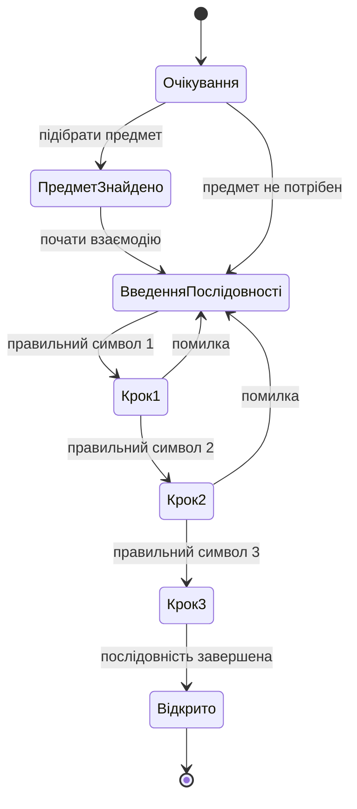

# Діаграма станів

Діаграма описує стани головоломки з трьома символами.

## Пояснення станів
| Стан | Значення |
|---|---|
| Очікування | Гравець ще не почав розв'язувати механізм |
| Предмет знайдено | Необхідний предмет у гравця |
| Введення послідовності | Механізм приймає натискання символів |
| Крок 1–3 | Зафіксовано відповідну частину правильної послідовності |
| Відкрито | Прохід активовано, головоломку завершено |

## Події та переходи
Основні події: підбирання предмета, початок взаємодії, правильний символ, неправильний символ, завершення послідовності. Неправильний символ повертає головоломку до початку введення, а три правильні символи відкривають прохід.
