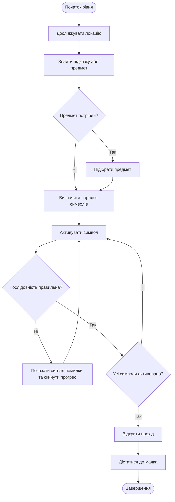

# Схема та псевдокод

## Схема основного циклу


## Псевдокод
```text
почати_рівень()
зібрано_предмет = false
поточний_крок = 0
правильний_порядок = [ЛИСТОК, КРАПЛЯ, ЗІРКА]

поки рівень_не_завершено:
    подія = чекати_дію_гравця()

    якщо подія == "підібрати_предмет":
        зібрано_предмет = true
        показати_повідомлення("Предмет знайдено")

    якщо подія == "активувати_символ":
        якщо потрібен_предмет і не зібрано_предмет:
            показати_підказку("Спочатку знайдіть предмет")
        інакше:
            якщо символ == правильний_порядок[поточний_крок]:
                поточний_крок += 1
                показати_успіх()
            інакше:
                поточний_крок = 0
                показати_помилку()

    якщо поточний_крок == довжина(правильний_порядок):
        відкрити_прохід()
        рівень_не_завершено = false

показати_маяк()
завершити_рівень()
```

## Вхідні та вихідні дані
- Вхідні: дія гравця, обраний символ, стан предмета, поточний крок.
- Вихідні: повідомлення про успіх/помилку, оновлений прогрес, стан проходу (закрито/відкрито).
